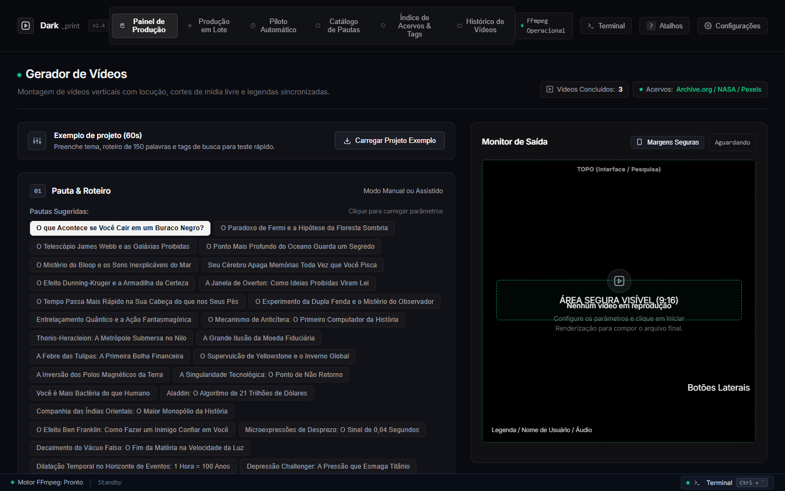
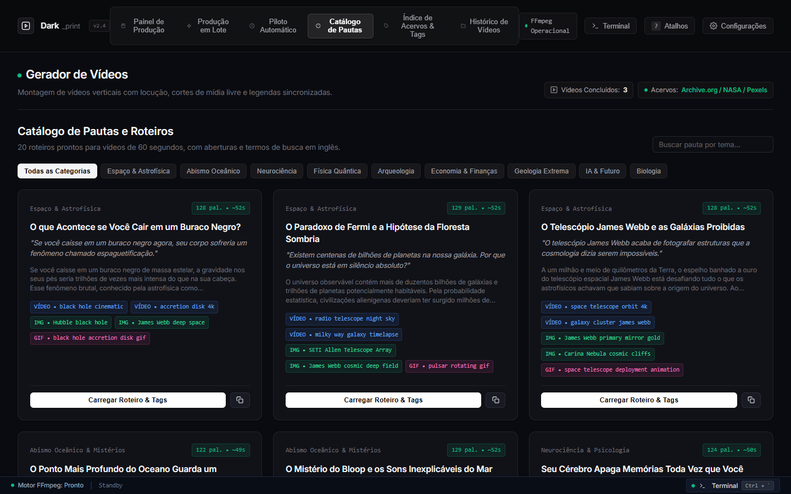
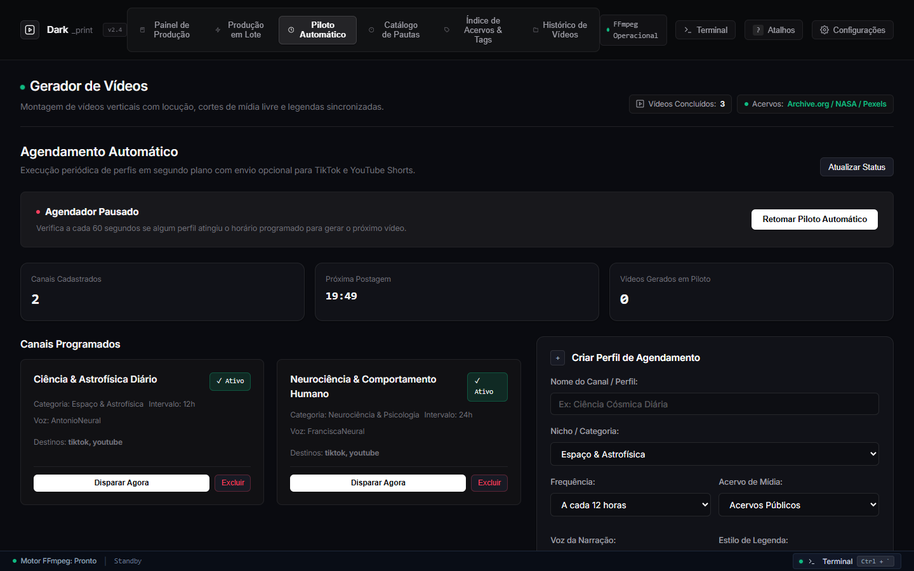
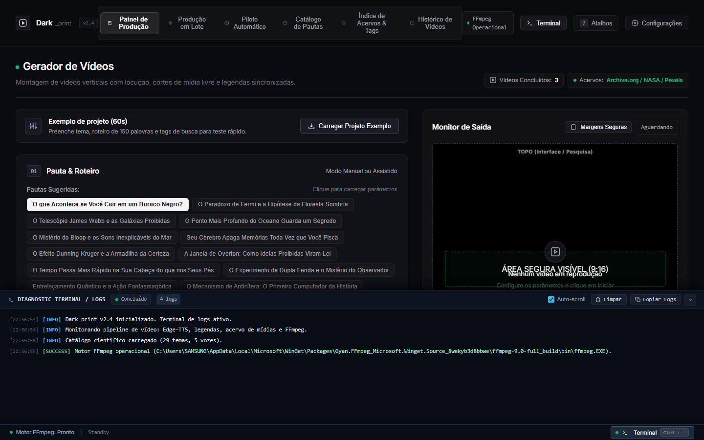

# Dark_print

Gerador de vídeos verticais para YouTube Shorts, TikTok e Instagram Reels.

A partir de um tema ou roteiro em texto, o Dark_print gera a locução em português, baixa vídeos e imagens de acervos públicos, sintetiza efeitos sonoros nos cortes de cena, mistura a trilha de fundo e renderiza o arquivo final com legendas sincronizadas.

<p align="center">
  
</p>

---

## O que o sistema faz

### Busca de mídia sem chave de API

Por padrão, o sistema busca clipes e imagens diretamente em acervos públicos que não exigem cadastro:
- Internet Archive e Prelinger Archives (filmes históricos, documentários e gravações em domínio público via API do archive.org)
- NASA Image and Video Library (imagens e vídeos espaciais)
- Wikimedia Commons e Openverse (fotos, gravuras e animações sob licença Creative Commons)

Quem preferir bancos comerciais pode adicionar chaves gratuitas do Pexels ou Pixabay nas configurações, ou usar vídeos próprios na pasta local.

### Efeitos sonoros gerados via código

Os efeitos de transição são sintetizados direto em Python com os módulos nativos `wave`, `struct` e `math` (WAV 16-bit, 44.1kHz), sem depender de pacotes externos de áudio. O pipeline insere um impacto sub-bass (808) no primeiro segundo do vídeo, antecipa cortes de cena em 50ms com som de *whoosh* e adiciona cliques mecânicos e *risers* ao longo da montagem.

### Trilha sonora (Incompetech)

Integra o catálogo de Kevin MacLeod com mais de 1.400 faixas em cache local (`storage/cache/incompetech_pieces.json`) e 22 músicas pré-configuradas para uso offline (*Sneaky Snitch*, *Cipher*, *Carefree*, *Darkest Child*, entre outras). É possível filtrar por gênero, clima e BPM. Ao final da renderização, o sistema gera o bloco de atribuição CC-BY 4.0 pronto para colar na descrição do vídeo.

### Catálogo de pautas e análise de roteiro

Inclui 20 roteiros prontos sobre ciência, história, espaço e economia, já acompanhados de termos de busca em inglês para extração de vídeos. Antes de renderizar, o analisador mede a velocidade de leitura em palavras por segundo, avalia as primeiras frases do texto e sugere três variações de abertura para teste.

<p align="center">
  
</p>

### Comentários fixados e estimativa de receita

Junto com o vídeo, o painel gera sugestões de títulos, hashtags e texto de comentário fixado com palavras-chave para automação de respostas ou chamada para vídeos longos. Também inclui avisos de transparência (FTC/CONAR) para links de afiliados e uma calculadora simples de RPM por região.

### Agendamento em segundo plano

Permite criar perfis por tema com intervalo fixo de execução (a cada 6, 12 ou 24 horas). Quando ativo, o agendador sorteia uma pauta inédita, renderiza o vídeo e, se configurado com a API do Upload-Post, envia o arquivo para o TikTok e YouTube Shorts.

<p align="center">
  
</p>

### Terminal de logs no navegador

O rodapé da interface traz um console retrátil (atalho `Ctrl + ~` ou `Ctrl + \``) que transmite em tempo real os logs do FFmpeg, downloads de mídia e status da fila de renderização.

<p align="center">
  
</p>

---

## Estrutura do Projeto

```text
Dark_print/
├── app/
│   ├── controllers/v1/      # Rotas da API FastAPI
│   ├── models/              # Schemas Pydantic e constantes
│   ├── services/            # Serviços de geração de vídeo e áudio
│   │   ├── autopilot.py     # Agendador de perfis em segundo plano
│   │   ├── incompetech_bgm.py # Catálogo musical e atribuição CC-BY
│   │   ├── material.py      # Busca de mídia (Archive.org, NASA, Wikimedia)
│   │   ├── monetization_funnel.py # Comentários fixados e cálculo de RPM
│   │   ├── sfx.py           # Síntese de efeitos sonoros em WAV
│   │   ├── task.py          # Fila e etapas de processamento
│   │   ├── video.py         # Composição e corte via MoviePy/FFmpeg
│   │   └── viral_analytics.py # Métricas de ritmo e variações de abertura
│   └── utils/               # Utilitários de sistema, cache e arquivos
├── resource/
│   ├── public/              # Interface Web (HTML, CSS, JS)
│   └── sfx/                 # Arquivos de efeitos sonoros gerados
├── test/
│   └── services/            # Testes unitários e de integração
├── config.toml.example      # Exemplo de arquivo de configuração
├── pyproject.toml           # Dependências do Python
└── start_studio.bat         # Inicializador para Windows
```

---

## Requisitos

- Python 3.11 ou superior
- FFmpeg instalado e disponível no `PATH` do sistema
- Git

---

## Instalação e Execução

### 1. Clonar o repositório

```bash
git clone https://github.com/Glawther/Dark_print.git
cd Dark_print
```

### 2. Criar o ambiente virtual

Com `uv`:
```bash
uv sync --frozen
```

Ou com `venv` e `pip`:
```bash
python -m venv .venv

# Windows
.\.venv\Scripts\activate

# Linux / macOS
source .venv/bin/activate

pip install -r requirements.txt
```

### 3. Configurar chaves opcionais

Copie o arquivo de exemplo se quiser configurar provedores de LLM (Gemini, OpenAI, DeepSeek) ou chaves do Pexels e Pixabay:
```bash
cp config.toml.example config.toml
```

As fontes públicas (Archive.org, NASA, Wikimedia, Openverse) e a locução via Edge-TTS funcionam sem chave de API.

### 4. Iniciar o servidor

No Windows:
```cmd
start_studio.bat
```

Pelo terminal em qualquer sistema:
```bash
python main.py
```

O servidor inicia em `http://127.0.0.1:8080`.

---

## Testes

```bash
python -m pytest test/services/test_archive_org.py test/services/test_autopilot.py test/services/test_incompetech.py test/services/test_monetization_funnel.py test/services/test_sfx.py test/services/test_viral_analytics.py -v
```

---

## Principais rotas da API

| Método | Endpoint | Descrição |
|---|---|---|
| `GET` | `/api/v1/saas/bgm/incompetech` | Busca faixas musicais por gênero, clima e BPM |
| `POST` | `/api/v1/saas/script/analyze` | Calcula ritmo de leitura e sugere aberturas alternativas |
| `POST` | `/api/v1/saas/monetization/funnel` | Gera texto de comentário fixado e estimativa de RPM |
| `POST` | `/api/v1/saas/autopilot/profiles` | Cria perfil de agendamento em segundo plano |
| `POST` | `/api/v1/saas/autopilot/trigger/{id}` | Inicia uma execução imediata do perfil agendado |
| `GET` | `/api/v1/saas/tasks/{id}/metadata` | Retorna título, descrição, hashtags e atribuição da trilha |

---

## Licença

Distribuído sob a licença [MIT](LICENSE).
